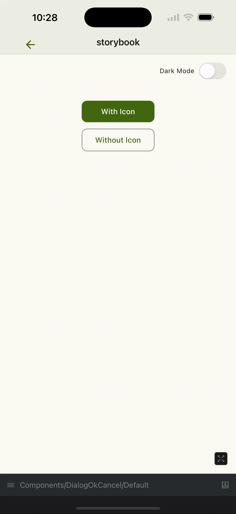

# React Native Common Module

This repository contains common components, utilities, and services used across React Native Expo applications.

[](https://github.com/RichardLitt/standard-readme)
[](https://www.typescriptlang.org/)
[](https://bun.sh/)
[](https://react.dev/)
[](.nvmrc)
[](https://jestjs.io/)
[](https://reactnative.dev/)
[](https://expo.dev/)

[](https://github.com/Lichens-Innovation/react-native-common) [](https://www.npmjs.com/package/@lichens-innovation/react-native-common) [](https://github.com/semantic-release/semantic-release)

Table of content

- [React Native Common Module](#react-native-common-module)
  - [Reusable Components](#reusable-components)
    - [Examples](#examples)
  - [Services, Utilities and Hooks](#services-utilities-and-hooks)
  - [Consume in a project](#consume-in-a-project)
    - [Adding the dependency to an existing mobile application](#adding-the-dependency-to-an-existing-mobile-application)
    - [Upgrading from 3.x (Expo SDK 54) to 4.x (Expo SDK 58)](#upgrading-from-3x-expo-sdk-54-to-4x-expo-sdk-58)
    - [Basic Usage Example](#basic-usage-example)
  - [Optional modules](#optional-modules)
    - [RJSF (`@lichens-innovation/react-native-common/rjsf`)](#rjsf-lichens-innovationreact-native-commonrjsf)
  - [Contributions](#contributions)
    - [Releases](#releases)
    - [Prerequisites](#prerequisites)
    - [Installation](#installation)
    - [Scripts](#scripts)
    - [Git hooks](#git-hooks)
  - [Peer Dependencies](#peer-dependencies)
    - [Why Peer Dependencies?](#why-peer-dependencies)
    - [Our Implementation Strategy](#our-implementation-strategy)
    - [Why devDependencies + peerDependencies?](#why-devdependencies--peerdependencies)
  - [WinRT integration](#winrt-integration)
  - [Project coding guidelines](#project-coding-guidelines)
    - [Coding-guide policy](#coding-guide-policy)
  - [Unit tests](#unit-tests)
    - [Coverage](#coverage)
  - [License](#license)

## Reusable Components

- Safe area containers, centered layouts, tab bar components
- ErrorBoundary, Snackbar notifications, loading spinners, progress indicators
- various interactive components (dropdowns, bottom sheets, etc.)
- global theme and light/dark modes support

### Examples

|                        Vertical Split View                        |                        Dialog Ok/Cancel                        |
| :---------------------------------------------------------------: | :------------------------------------------------------------: |
|  |  |

- [Components Catalog](docs/catalog.md)

## Services, Utilities and Hooks

- `@tanstack/react-query` hooks
- `MMKV`-based efficient data persistence (native storage solution)
- HTTP `Axios` configuration, Digest authentication support
- File operations, image processing, filename management
- Device detection (`Bonjour` service) environment config
- WiFi and available networks detection
- hooks for Expo updates detection, image picking, animations...
- `WebView` integration hooks and utilities
- `MobX` stores (common state, in-memory logs)
- I18N internationalization (`i18next` setup and files)
- `logging` service (`Sentry`, file-base, console, in-memory)
- various helper functions (strings, dates, base64...)
- types, interfaces, constants

## Consume in a project

Depending on your Expo SDK version, here are the compatibility table for `react-native-common` module:

| Version Family | Expo SDK Version | Description                                           |
| -------------- | ---------------- | ----------------------------------------------------- |
| 1.x.y          | SDK 52, SDK 53   | Compatible with applications using Expo SDK 52 and 53 |
| 2.x.y, 3.x.y   | SDK 54           | Compatible with applications using Expo SDK 54        |
| 4.x.y          | SDK 58           | Compatible with applications using Expo SDK 58        |

### Adding the dependency to an existing mobile application

The following will install the latest available version on your react-native app, pinned to an exact version:

```bash
yarn add --exact @lichens-innovation/react-native-common
```

### Upgrading from 3.x (Expo SDK 54) to 4.x (Expo SDK 58)

Starting with Expo SDK 56, `expo-router` ships its own navigation implementation. Navigation hooks and contexts imported from `@react-navigation/*` no longer match the ones provided by `expo-router`, so version 4.x imports them from `expo-router/react-navigation` instead.

1. Upgrade the application to Expo SDK 58 (`expo` >= 58, `expo-router` >= 58, `react-native` >= 0.88, `react` >= 19.3).
2. Repoint the application's own `@react-navigation/*` imports to `expo-router`:

   ```bash
   npx expo-codemod sdk-56-expo-router-react-navigation-replace src
   ```

3. Remove `@react-navigation/native` from the application dependencies if nothing else requires it (it is no longer a peer dependency of this package).
4. `NAVIGATION_DARK` / `NAVIGATION_LIGHT` themes are meant for the `ThemeProvider` exported by `expo-router/react-navigation`.

### Basic Usage Example

Here's how to import and use the `DialogOkCancel` component:

```tsx
import { DialogOkCancel } from '@lichens-innovation/react-native-common';
import React, { useState } from 'react';
import { Button } from 'react-native-paper';

export const MyComponent = () => {
  const [showDialog, setShowDialog] = useState(false);

  const handleOk = () => {
    console.log('User confirmed');
    setShowDialog(false);
  };

  const handleCancel = () => {
    console.log('User cancelled');
    setShowDialog(false);
  };

  return (
    <>
      <Button onPress={() => setShowDialog(true)}>Show Dialog</Button>

      <DialogOkCancel
        isVisible={showDialog}
        title="Confirm Action"
        description="Are you sure you want to proceed with this action?"
        onOk={handleOk}
        onCancel={handleCancel}
      />
    </>
  );
};
```

## Optional modules

This package provides optional subpath modules with external dependencies. Install only the dependencies you need when using a given subpath.

### RJSF (`@lichens-innovation/react-native-common/rjsf`)

[React JSON Schema Form (RJSF)](https://rjsf-team.github.io/react-jsonschema-form/) renderer with React Native Paper: themed form layout, localized validation (ajv-i18n), and widgets (date, datetime, select, checkboxes, etc.). Builds on `@lichens-innovation/ts-common/rjsf` for i18n and validation.

**Install the dependencies:**

The RJSF components in `src/components/rjsf` depend on the following packages. Install the **required** ones, then add **optional** ones according to the widgets or features you use.

```bash
# Required
yarn add @rjsf/core @rjsf/utils @rjsf/validator-ajv8 ajv-i18n i18next

# Optional (if not already in your app)
#  - @react-native-community/datetimepicker — for DateWidget and DateTimeWidget
#  - @react-native-community/slider — for RangeWidget
yarn add @react-native-community/datetimepicker @react-native-community/slider
```

**Usage example:**

```tsx
import { RjsfPaperRenderer } from '@lichens-innovation/react-native-common/rjsf';
import type { RJSFSchema } from '@rjsf/utils';
import { useTranslation } from 'react-i18next';

const schema: RJSFSchema = { type: 'object', properties: { name: { type: 'string', title: 'Name' } } };

export const MyForm = () => {
  const { i18n } = useTranslation();

  return <RjsfPaperRenderer schema={schema} i18n={i18n} onSubmit={({ formData }) => console.info(formData)} />;
};
```

## Contributions

Contributions to the project are made by simply improving the current codebase and then creating a Pull Request. CI ([.github/workflows/ci.yml](.github/workflows/ci.yml)) runs on every PR.

### Releases

Releases are fully automated by [semantic-release](https://github.com/semantic-release/semantic-release): do **not** bump the `version` field in `package.json` manually. When a PR is squash-merged into `main`, the PR title (which becomes the commit message) is analyzed to determine the next version, then the package is published to npm, `CHANGELOG.md` and `package.json` are updated, and a GitHub release is created.

PR titles must therefore follow [Conventional Commits](https://www.conventionalcommits.org/) (checked in CI):

| PR title                                   | Release |
| ------------------------------------------ | ------- |
| `fix: ...`                                 | patch   |
| `feat: ...`                                | minor   |
| `feat!: ...` or `BREAKING CHANGE:` in body | major   |
| `chore: ...`, `docs: ...`, `ci: ...`, etc. | none    |

Major versions are aligned with Expo SDK versions (see the compatibility table above): only use `!` / `BREAKING CHANGE` for real breaking changes.

### Prerequisites

- Node.js (version in [.nvmrc](.nvmrc))
- [Bun](https://bun.sh/) (version in the `packageManager` field of [package.json](package.json))
- React Native development environment set up (see [React Native documentation](https://reactnative.dev/docs/environment-setup))

### Installation

```bash
git clone https://github.com/Lichens-Innovation/react-native-common.git
cd react-native-common
bun install
```

### Scripts

All scripts are defined in [package.json](package.json). Day-to-day ones:

| Command                 | Description                                                        |
| ----------------------- | ------------------------------------------------------------------ |
| `bun run build`         | Bundles the package into `dist/`                                   |
| `bun run typecheck`     | Checks TypeScript types without emitting files                     |
| `bun run test`          | Runs the unit tests                                                |
| `bun run test:coverage` | Runs the unit tests with the [coverage threshold](#coverage)       |
| `bun run lint`          | Coding-guide check on the whole project (what CI runs)             |
| `bun run habit:hooks`   | Coding-guide check on files changed since `main` (run before a PR) |
| `bun run format`        | Formats all files with Prettier                                    |

### Git hooks

Husky installs the hooks in [.husky/](.husky) on `bun install` (`prepare` script). They run a fast subset of the CI checks locally: commit message format on `commit-msg`, checks on staged files on `pre-commit`, whole-project checks (including tests with the coverage threshold) on `pre-push`. Read the hook files for the exact list.

## Peer Dependencies

This package uses a **peer dependencies** approach for all React Native, Expo, and shared ecosystem libraries. Here's why and how it works:

### Why Peer Dependencies?

- **Avoid duplicate packages**: Prevents bundling the same libraries multiple times in the final app
- **Version control**: The consuming app controls the exact versions of critical dependencies like React Native and Expo
- **Bundle size optimization**: Reduces the final app bundle size by sharing common dependencies
- **Consistency**: Ensures all parts of the app use the same version of core libraries

### Our Implementation Strategy

We keep dependencies in three categories:

1. **`dependencies`**: Pure utility libraries specific to this package (date-fns, immer, handlebars, etc.)
2. **`devDependencies`**: All React Native, Expo, and ecosystem packages needed for compilation and type checking
3. **`peerDependencies`**: Same packages as devDependencies, indicating what the consuming app must provide

### Why devDependencies + peerDependencies?

This dual approach solves the compilation problem while maintaining clean dependency resolution:

- **`devDependencies`** provide the necessary packages and types for TypeScript compilation
- **`peerDependencies`** inform the consuming app about required dependencies and versions
- The final app bundle only includes one copy of each shared dependency

## WinRT integration

Interfaces and types are generated by the `react-native-winrt` package at build time of the desktop application. To ensure compatibility and avoid conflicts, the generated types should be placed in the `src/types/winrt` folder of current project. Here's how to do it. Copy all generated types from:

- `my-app-desktop\node_modules\react-native-winrt\windows\WinRTTurboModule\Generated Files\types\`
- to `src\types\winrt\`

## Project coding guidelines

Coding standards are enforced by ESLint (see [eslint.config.mjs](eslint.config.mjs)) and [`@lichens-innovation/eslint-plugin-coding-guide`](https://github.com/Lichens-Innovation/eslint-plugin-coding-guide), which ships both the `coding-guide/*` rules and the `coding-guide` CLI. The CLI runs several sensors (ESLint, knip, comments, duplication, ...) and prints a coaching guide per smell; it is configured in [.coding-guide/config.json](.coding-guide/config.json).

- `bun run lint`: whole project, what CI runs
- `bun run habit:hooks`: files changed since `main`, run it before opening a PR
- `bunx coding-guide check --file <path>`: one file
- `// eslint-disable-next-line <rule> -- <reason>`: one justified exception to an ESLint rule, visible in review

Background reading: [Coding guidelines](https://github.com/amwebexpert/chrome-extensions-collection/blob/master/packages/coding-guide-helper/public/markdowns/table-of-content.md), [rules list](https://github.com/Lichens-Innovation/eslint-plugin-coding-guide/blob/main/docs/rules/README.md), [CLI](https://github.com/Lichens-Innovation/eslint-plugin-coding-guide/blob/main/docs/cli.md).

### Coding-guide policy

- The whole codebase is held to the standard: there is no snooze list (`.coding-guide/snooze.json` stays empty) and CI fails on any enforced finding.
- Fix a finding rather than silencing it. A justified exception (a workaround, a public API constraint) gets a disable comment that states why, e.g. `// eslint-disable-next-line <rule> -- <reason>` (`coding-guide-disable-next-line` directives are themselves reported as comments by the current CLI, so prefer the ESLint form).
- Comments explain _why_, never _what_: a comment that must stay carries the `habit-hooks-disable non-essential-comment` marker at the end of its first line.
- `suggested` smells (duplication, some `react-hooks/*` rules) are printed but don't block: fix them when the fix is a genuine improvement.

## Unit tests

Tests run on [Jest](https://jestjs.io/) with the [`jest-expo`](https://docs.expo.dev/develop/unit-testing/) preset and [React Native Testing Library](https://callstack.github.io/react-native-testing-library/) for components and hooks.

- `tests/` holds behaviour tests written against the public API only: import from `@lib` (the package entry, `src/react-native-common.index.ts`) or `@lib/rjsf`, never from an internal path, so a refactor that keeps the API keeps the tests green. Unit tests of a single module may live next to it (`src/**/*.test.ts`).
- [jest.setup.ts](jest.setup.ts) mocks the native modules; override a mock per test with `jest.mocked(...)` or a local `jest.mock` factory.
- React Native Testing Library is async: always `await render(...)`, `await renderHook(...)`, `await fireEvent.press(...)`.
- Mark test phases with `// arrange`, `// act`, `// assert` (enforced by `coding-guide/require-aaa-comments`).

### Coverage

`bun run test:coverage` measures coverage of the sources (`collectCoverageFrom` in [jest.config.js](jest.config.js)), prints a summary and writes an HTML report to `coverage/lcov-report/index.html`. CI uploads the same report as the `coverage` artifact of each run.

Minimum coverage is set by `coverageThreshold` in [jest.config.js](jest.config.js) and enforced in CI and in the `pre-push` hook: a change that drops coverage below it fails. When coverage rises, raise the threshold in the same PR so it cannot slip back.

## License

This project is licensed under the MIT License - see the [LICENSE](LICENSE) file for details.
